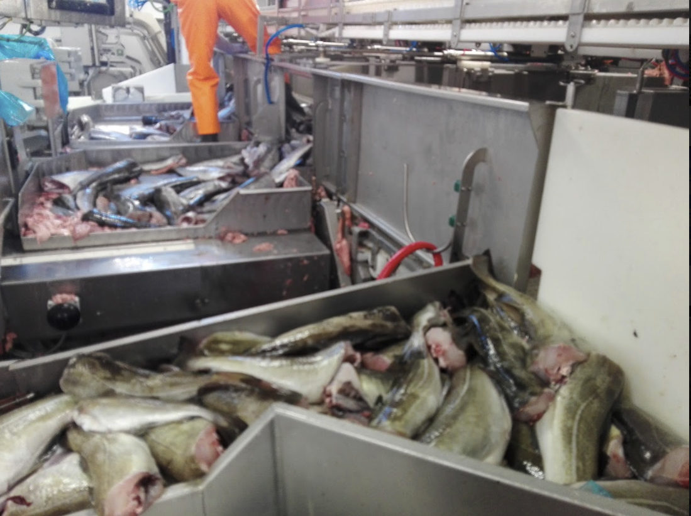
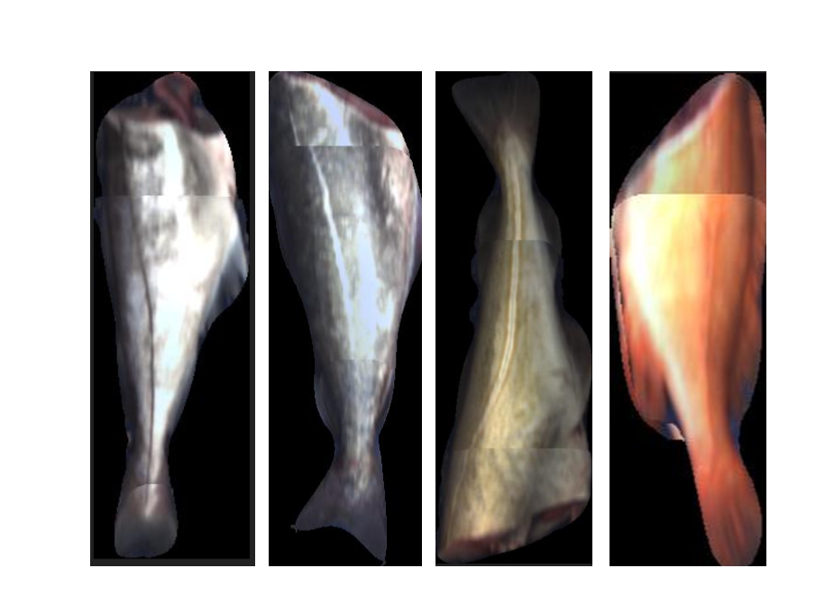
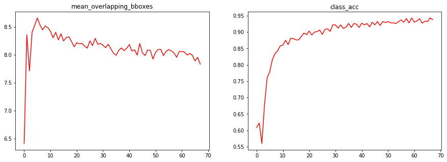
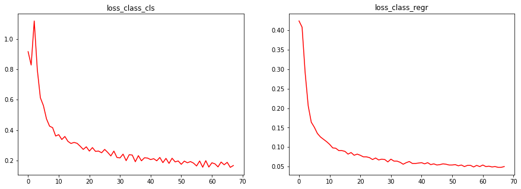
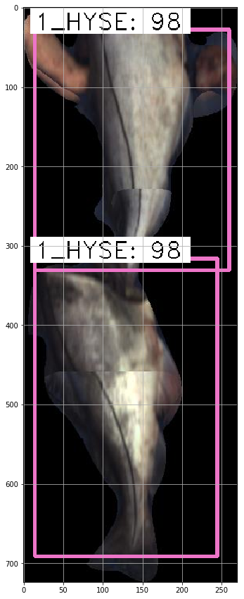

# Industrial Computer Vision: Conveyor-Belt Cod Species Classification & Length Measurement (Faster R-CNN / Keras)

[](LICENSE)
[](https://python.org/)
[-FF6F00?style=flat-square)](https://keras.io/)
[](https://github.com/lgcorzo)

> **Industrial Context:** Developed for automated fish-processing lines where an overhead RGB camera inspects fish moving at **2 units/second** on a conveyor belt, stitches multi-frame captures into full longitudinal views, and classifies each specimen into four species (**`HYSE`**, **`SEI`**, **`TORSK`**, **`LASK`**) while measuring bounding-box length to route items to the corresponding processing hopper.

---

## 1. Industrial Problem & Conveyor Pipeline

Depending on the species and size of each fish entering the factory line, downstream cutting and sorting machinery applies different processing recipes. Manual sorting creates a bottleneck, so an automated overhead RGB vision station performs real-time detection, species classification, and length estimation:



### Multi-Frame Longitudinal Stitching & Background Removal
Because the camera's field of view is narrower than a full specimen on the moving belt, the acquisition pipeline:
1. Captures sequential RGB frames as the fish passes under the camera.
2. Segments and removes the conveyor background.
3. Assembles the fish longitudinally into a single composite frame at a throughput of **2 fish/second** (`< 500 ms` budget per inference).



---

## 2. Model Architecture: Faster R-CNN with VGG-16 Backbone

To avoid brittle hand-crafted morphological parameterizations across lighting and scale variations, the pipeline uses **Faster R-CNN** with a pre-trained **VGG-16** backbone (`nn_base`), combining a **Region Proposal Network (RPN)** with a Fast R-CNN detector and bounding-box regressor:

- **Shared Convolutional Feature Map (VGG-16):** Extracts spatial feature maps from each stitched conveyor image.
- **Region Proposal Network (RPN):** Slides a `3×3` window across the feature map and evaluates `k` anchor boxes per position, outputting objectness scores (`2k` softmax probabilities) and `4k` bounding-box regression offsets:


- **RoI Pooling & Classification Head:** Projects high-scoring proposals into fixed-size feature maps, classifying the region into **`HYSE`**, **`SEI`**, **`TORSK`**, or **`LASK`** while refining the bounding box coordinates used for physical length estimation:


---

## 3. Repository Structure & Notebooks

| File / Directory | Description |
| :--- | :--- |
| [`Object_Detection_DataPreprocessing_granit.ipynb`](./Object_Detection_DataPreprocessing_granit.ipynb) | Parses raw bounding-box annotations (`train.csv`, `test.csv`) and generates Faster R-CNN training manifest files (`annotation.txt`, `test_annotation.txt`). |
| [`frcnn_train_vgg.ipynb`](./frcnn_train_vgg.ipynb) | End-to-end Faster R-CNN training notebook (VGG-16 backbone, RPN + classifier heads, data augmentation with horizontal/vertical flips and rotations, 1,000 samples/epoch). |
| [`frcnn_test_vgg.ipynb`](./frcnn_test_vgg.ipynb) / [`frcnn_test_vgg_granit.ipynb`](./frcnn_test_vgg_granit.ipynb) | Evaluation and inference notebooks computing mAP, bounding-box localization, class probabilities, and per-frame latency on held-out conveyor captures. |
| `train/` & `test/` | Sample RGB conveyor captures (`RGB_*.jpg`) and corresponding bounding-box annotations. |
| `model/` & `Trained/` | Model configuration (`model_vgg_config.pickle`), training epoch logs (`record.csv`), and loss/accuracy telemetry. |

---

## 4. Training Telemetry & Industrial Performance

Training was conducted on an NVIDIA Tesla K80 GPU using 1,000 augmented samples per epoch (rotations, translations, and mirror flips) from `annotation.txt`:


### Convergence & Loss Curves (68,000 Batches / 40 Epochs)

| Metric | Result |
| :--- | :--- |
| **Classification Accuracy** | **94.4% – 95.0%** (converges cleanly around epoch 30 without overfitting) |
| **Inference Latency** | **~500 ms – 728 ms** per composite frame |
| **Target Classes** | `1_HYSE` (Haddock), `2_SEI` (Saithe), `3_TORSK` (Atlantic Cod), `4_LASK` (Salmon) |






### Sample Inference Output



```text
Elapsed time = 0.728 s
Detections: [('1_HYSE', 98.97%), ('1_HYSE', 98.18%)]
```

---

## 5. References & License

- Ren, S., He, K., Girshick, R., & Sun, J. (2015). *Faster R-CNN: Towards Real-Time Object Detection with Region Proposal Networks*. Advances in Neural Information Processing Systems (NeurIPS).
- Licensed under the [MIT License](./LICENSE).
