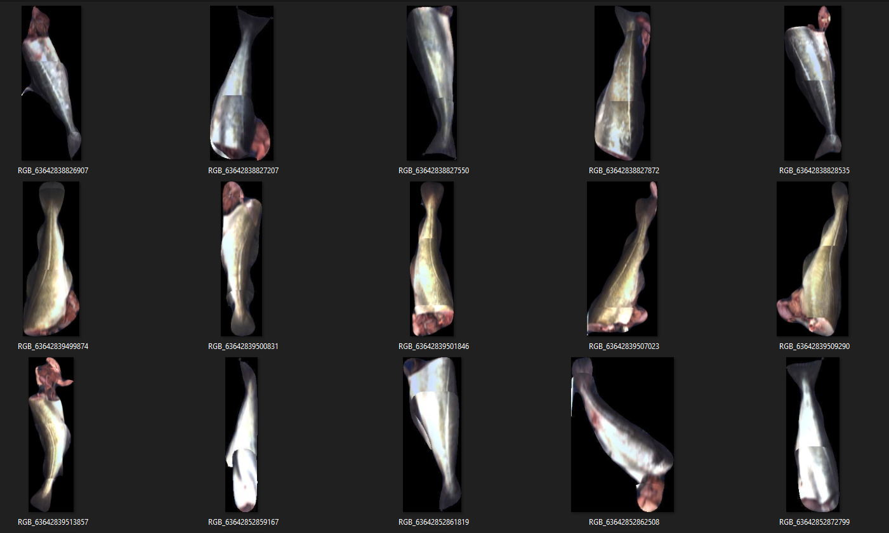
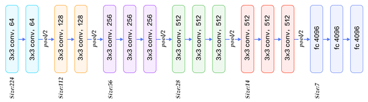
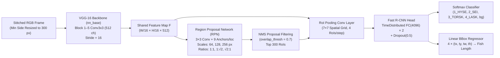
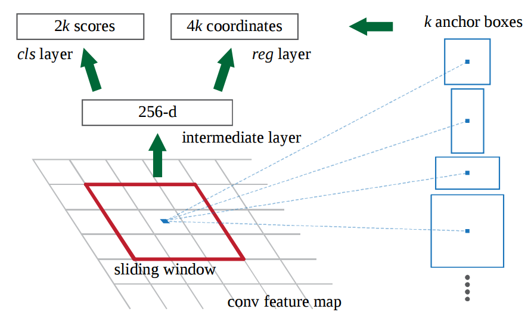
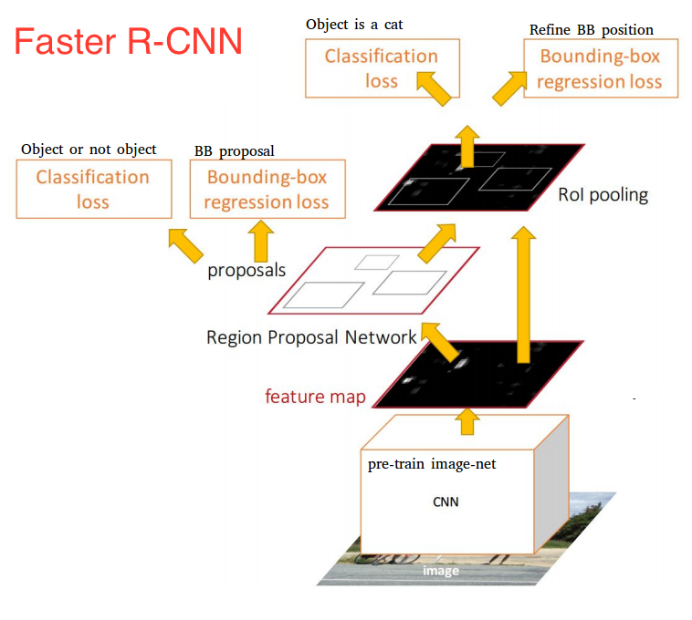
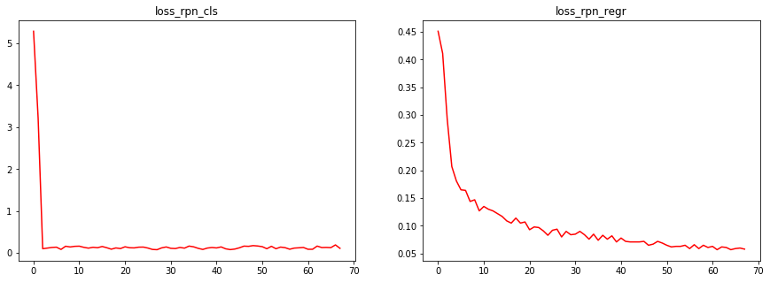
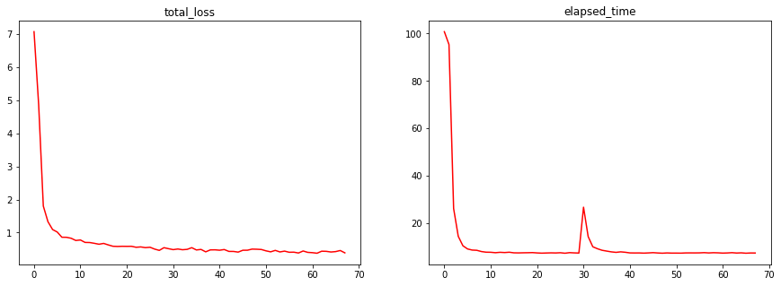

# Industrial Computer Vision: Conveyor-Belt Fish Species Classification & Length Measurement (Faster R-CNN / VGG-16 / Keras)

[](LICENSE)
[](https://python.org/)
[-FF6F00?style=flat-square)](https://keras.io/)
[](https://github.com/lgcorzo)
[](#5-training-telemetry--empirical-evaluation)

> **Industrial Context & Scope:** Developed for automated Nordic whitefish and salmonid processing lines (`GRANIT` industrial dataset). An overhead line/area camera station inspects headed-and-gutted fish moving at **2 units/second** (`500 ms` takt time) along a conveyor belt, segments the conveyor background, stitches sequential frames longitudinally into composite specimens, and performs simultaneous **4-class species classification** (**`1_HYSE`**, **`2_SEI`**, **`3_TORSK`**, **`4_LASK`**) and **bounding-box length measurement** to actuate downstream sorting hoppers.

---

## Table of Contents

1. [Industrial Problem & Conveyor Sorting Pipeline](#1-industrial-problem--conveyor-sorting-pipeline)
2. [Dataset Inventory & Train/Test Split Analysis](#2-dataset-inventory--traintest-split-analysis)
3. [Model Architecture & Hyperparameter Configuration](#3-model-architecture--hyperparameter-configuration)
4. [Repository Structure & Execution Workflow](#4-repository-structure--execution-workflow)
5. [Training Telemetry & Empirical Evaluation](#5-training-telemetry--empirical-evaluation)
6. [Engineering Analysis: Original Baseline vs. Modern Edge Vision](#6-engineering-analysis-original-baseline-vs-modern-edge-vision)
7. [References & License](#7-references--license)

---

## 1. Industrial Problem & Conveyor Sorting Pipeline

In high-throughput seafood processing factories, downstream cutting, filleting, and portioning machinery requires species-specific and size-specific mechanical parameters. Manual sorting at the infeed conveyor creates an operational bottleneck, motivating an automated overhead computer vision station capable of:

1. **Species Classification:** Distinguishing four commercial North Atlantic / Norwegian fisheries species (`HYSE`, `SEI`, `TORSK`, `LASK`).
2. **Physical Length Estimation:** Computing the longitudinal bounding-box span ($\Delta y = y_2 - y_1$ and $\Delta x = x_2 - x_1$ in calibrated conveyor pixels) to grade specimens into size-specific hoppers.


### Multi-Frame Longitudinal Stitching & Background Removal

Because a single camera field of view is narrower than a full specimen traveling at high speed on the belt, the upstream acquisition pipeline performs:

1. **Sequential Frame Capture:** Acquires synchronized **RGB** (`RGB_*.jpg`) and **Near-Infrared** (`NIR_*.jpg`) frames as each fish crosses the inspection line.
2. **Background Segmentation:** Strips the conveyor belt background, isolating the fish silhouette on a zeroed (`0, 0, 0`) canvas.
3. **Longitudinal Frame Assembly:** Concatenates sequential slices into a single composite image (visible as horizontal stitching seams across long specimens) at a line cadence of **2 fish/second**.



### Target Species Taxonomy

| Class ID | Label Code | Norwegian Name | English Common Name | Scientific Name | Morphometric Profile in Dataset (Median $\text{W} \times \text{H}$ px) |
| :---: | :--- | :--- | :--- | :--- | :---: |
| `0` | **`1_HYSE`** | Hyse | Haddock | *Melanogrammus aeglefinus* | $196 \times 438\text{ px}$ (distinct dark lateral line, pale belly) |
| `1` | **`2_SEI`** | Sei | Saithe / Pollock | *Pollachius virens* | $166 \times 412\text{ px}$ (straight pale lateral line, darker dorsum) |
| `2` | **`3_TORSK`** | Torsk | Atlantic Cod | *Gadus morhua* | $187 \times 476\text{ px}$ (mottled olive/brown skin, curved lateral line) |
| `3` | **`4_LASK`** | Laks (`LASK`) | Atlantic Salmon | *Salmo salar* | $186 \times 292\text{ px}$ (silver-pink pigmentation / fillet profile) |
| `4` | **`bg`** | — | Background | Negative Anchor Class | Non-object / conveyor background proposals |


---

## 2. Dataset Inventory & Train/Test Split Analysis

The repository includes the raw dual-spectrum corpus under [`Trained/`](./Trained) (`10,942` images total: `5,472` RGB and `5,470` NIR) and the preprocessed RGB detection splits under [`train/`](./train) and [`test/`](./test) generated by [`Object_Detection_DataPreprocessing_granit.ipynb`](./Object_Detection_DataPreprocessing_granit.ipynb).

### Complete Corpus Breakdown

| Class Directory | Total Raw Files (`Trained/`) | Raw RGB (`RGB_*.jpg`) | Raw NIR (`NIR_*.jpg`) | Training Split (`annotation.txt` / `train.csv`) | Test Split (`test_annotation.txt` / `test.csv`) | Bounding-Box Height Range ($\Delta y$ px) |
| :--- | ---: | ---: | ---: | ---: | ---: | :---: |
| [`Trained/0_Unknown`](./Trained/0_Unknown) | 438 | 219 | 219 | *Excluded* (0) | *Excluded* (0) | Unlabeled / rejected captures |
| [`Trained/1_HYSE`](./Trained/1_HYSE) | 1,406 | 703 | 703 | 703 | 0 | $80\text{ – }909\text{ px}$ (median $395\text{ px}$) |
| [`Trained/2_SEI`](./Trained/2_SEI) | 1,312 | 656 | 656 | 656 | 0 | $77\text{ – }856\text{ px}$ (median $371\text{ px}$) |
| [`Trained/3_TORSK`](./Trained/3_TORSK) | 7,658 | 3,829 | 3,829 | 800 | 3,029 | $66\text{ – }1,018\text{ px}$ (median $429\text{ px}$) |
| [`Trained/4_LASK`](./Trained/4_LASK) | 128 | 65 | 63 | 65 | 0 | $90\text{ – }564\text{ px}$ (median $263\text{ px}$) |
| **Total** | **10,942** | **5,472** | **5,470** | **2,224 rows** (`2,223` unique files)* | **3,029 rows** (`3,029` unique files) | — |

*\*Note: `train/` contains `2,223` unique `.jpg` files on disk because one filename is shared across two classes in `Trained/`, producing `2,224` rows in `annotation.txt`.*

> [!IMPORTANT]
> **Dataset Split & Weak-Supervision Characteristics (Code-Verified in [`Object_Detection_DataPreprocessing_granit.ipynb`](./Object_Detection_DataPreprocessing_granit.ipynb)):**
> 1. **800-Sample Cap Split Artifact:** Cell 8 slices each class after filtering out `NIR_*` images using `train_imgs = all_imgs[:800]` and `test_imgs = all_imgs[800:]`. Because only `3_TORSK` exceeds 800 RGB images (`3,829`), `test_annotation.txt` (`3,029` samples) consists **100% of `3_TORSK`** specimens. Multi-class out-of-sample evaluation was therefore performed using [`frcnn_test_vgg_granit.ipynb`](./frcnn_test_vgg_granit.ipynb) against separate production captures (`GRANIT_TRAINED_16.02.2018`).
> 2. **Weakly Supervised Bounding Boxes:** Because raw images are already background-segmented and cropped tightly around each specimen, preprocessing assigns a uniform normalized bounding box (`XMin=0.05, XMax=0.95, YMin=0.05, YMax=0.95`) converted into pixel coordinates in `annotation.txt`:
>    ```text
>    filepath,x1,y1,x2,y2,class_name
>    train/RGB_63642838276284.jpg,10,18,199,358,1_HYSE
>    ```



---

## 3. Model Architecture & Hyperparameter Configuration

Rather than relying on brittle hand-crafted morphological thresholds, the pipeline implements **Faster R-CNN** (Ren et al., 2015) with a **VGG-16** convolutional backbone (`nn_base`) in Keras (TensorFlow backend), jointly optimizing region proposal generation, multi-class species classification, and bounding-box regression.



### Architectural Components

1. **Shared VGG-16 Feature Extractor (`nn_base`):** Five convolutional blocks (`64 → 128 → 256 → 512 → 512` filters) with four $2 \times 2$ max-pooling stages yielding an effective spatial stride of `rpn_stride = 16`.
2. **Region Proposal Network (`rpn_layer`):** Slides a $3 \times 3$ window (`512` channels) over the shared feature map and branches into two $1 \times 1$ sibling convolutional layers evaluating $k = 9$ anchors per spatial location:
   - **Objectness head (`rpn_out_class`):** `9`-channel sigmoid output scoring foreground vs. background.
   - **Box regression head (`rpn_out_regress`):** `36`-channel linear output predicting $(\Delta x, \Delta y, \Delta w, \Delta h)$.



3. **Custom RoI Pooling Layer (`RoiPoolingConv`) & Fast R-CNN Detector (`classifier_layer`):** Projects each candidate region into a fixed $7 \times 7 \times 512$ tensor, passes it through two `TimeDistributed(Dense(4096, activation='relu'))` layers with `Dropout(0.5)`, and outputs class probabilities alongside class-specific bounding-box refinements:



### Serialized Configuration ([`model_vgg_config.pickle`](./model_vgg_config.pickle))

All training and inference parameters are persisted in `model_vgg_config.pickle` (`class Config`):

| Parameter | Value in `model_vgg_config.pickle` | Purpose |
| :--- | :--- | :--- |
| `network` | `'vgg'` | VGG-16 convolutional backbone |
| `im_size` | `300` | Shortest image side resized to `300 px` (preserving aspect ratio) |
| `anchor_box_scales` | `[64, 128, 256]` | Anchor box scales in pixels |
| `anchor_box_ratios` | `[[1, 1], [1/√2, √2], [√2, 1/√2]]` | Aspect ratios ($1:1$, $1:\sqrt{2}$, $\sqrt{2}:1$) → $k=9$ anchors |
| `rpn_stride` | `16` | Feature map downsampling factor from VGG-16 pooling |
| `rpn_min_overlap` / `rpn_max_overlap` | `0.3` / `0.7` | IoU thresholds for negative ($<0.3$) and positive ($>0.7$) RPN anchors |
| `classifier_min_overlap` / `max_overlap` | `0.1` / `0.5` | IoU thresholds for RoI background ($[0.1, 0.5)$) vs. foreground ($\ge 0.5$) |
| `num_rois` | `4` | Number of Regions of Interest processed per batch step |
| `use_horizontal_flips` / `vertical_flips` | `True` / `True` | Online spatial augmentation during training |
| `rot_90` | `True` | Random $90^\circ$ rotation augmentation during training |
| `img_channel_mean` | `[103.939, 116.779, 123.68]` | ImageNet BGR channel mean subtraction |
| `class_mapping` | `{'1_HYSE': 0, '2_SEI': 1, '3_TORSK': 2, '4_LASK': 3, 'bg': 4}` | Target index mapping |
| `optimizer` | `Adam(lr=1e-5)` | Optimizer for both `model_rpn` and `model_classifier` |

---

## 4. Repository Structure & Execution Workflow

| Path | Role & Contents |
| :--- | :--- |
| [`Object_Detection_DataPreprocessing_granit.ipynb`](./Object_Detection_DataPreprocessing_granit.ipynb) | Filters `RGB_*.jpg` captures from [`Trained/`](./Trained), builds `train/` (`2,223` files) and `test/` (`3,029` files), and writes [`train.csv`](./train.csv), [`test.csv`](./test.csv), [`annotation.txt`](./annotation.txt), and [`test_annotation.txt`](./test_annotation.txt). |
| [`frcnn_train_vgg.ipynb`](./frcnn_train_vgg.ipynb) | End-to-end Faster R-CNN training pipeline (`RoiPoolingConv`, `nn_base`, `rpn_layer`, `classifier_layer`, anchor target generator, multi-session checkpointing to `./model/model_frcnn_vgg.hdf5`, and epoch telemetry logging to [`model/record.csv`](./model/record.csv)). |
| [`frcnn_test_vgg.ipynb`](./frcnn_test_vgg.ipynb) | Evaluation notebook running inference and PASCAL VOC Average Precision (`get_map`, IoU $\ge 0.5$) on [`test_annotation.txt`](./test_annotation.txt). |
| [`frcnn_test_vgg_granit.ipynb`](./frcnn_test_vgg_granit.ipynb) | Production inference notebook testing multi-fish conveyor captures (`bbox_threshold = 0.7`, NMS `overlap_thresh = 0.2`) and rendering bounding boxes + confidence scores. |
| [`model/record.csv`](./model/record.csv) | Complete 68-epoch (`68,000` batches) training telemetry log recording accuracy, 4-part loss breakdown, overlapping RPN proposals, and per-epoch execution time. |
| [`model_vgg_config.pickle`](./model_vgg_config.pickle) | Pickled `Config` instance consumed by the test notebooks to reconstruct the exact network topology and preprocessing parameters. |
| [`Media/media/`](./Media/media) | Architectural diagrams, conveyor hopper photos, composite specimen examples, and training convergence plots (`image1.png` – `image11.png`). |
| [`Sistema de clasificación de bacalao con cámara RGB.docx`](./Sistema%20de%20clasificaci%C3%B3n%20de%20bacalao%20con%20c%C3%A1mara%20RGB.docx) | Original Spanish engineering case study report documenting the industrial problem, RPN theory, and experimental results. |

> [!NOTE]
> **External Model Weights (`> 100 MB`):** Pre-trained ImageNet weights (`./model/vgg16_weights_tf_dim_ordering_tf_kernels.h5`) and the trained Faster R-CNN checkpoint (`./model/model_frcnn_vgg.hdf5`) are excluded from Git tracking due to GitHub file-size limits and were mounted via Google Drive during Colab execution.

---

## 5. Training Telemetry & Empirical Evaluation

Training was executed on Google Colaboratory (NVIDIA Tesla K80 GPU) across two consecutive training sessions totaling **68 epochs** (`1,000` augmented batches per epoch = **68,000 batches**), logged in [`model/record.csv`](./model/record.csv):

### Epoch Progression Summary (Verified from [`model/record.csv`](./model/record.csv))

| Training Milestone | Epoch | Cumulative Batches | Mean Overlapping BBoxes | RoI Classifier Accuracy (`class_acc`) | RPN Cls Loss | RPN Regr Loss | Detector Cls Loss | Detector Regr Loss | Total Loss (`curr_loss`) |
| :--- | :---: | :---: | :---: | :---: | :---: | :---: | :---: | :---: | :---: |
| **Initial Epoch** | `1` | `1,000` | `6.414` | `60.9%` (`0.609`) | `5.288` | `0.451` | `0.916` | `0.424` | `7.079` |
| **Early Convergence** | `10` | `10,000` | `8.490` | `85.8%` (`0.858`) | `0.161` | `0.127` | `0.362` | `0.107` | `0.758` |
| **Session 1 Checkpoint** | `30` | `30,000` | `8.210` | `92.2%` (`0.922`) | `0.113` | `0.085` | `0.217` | `0.069` | `0.484` |
| **Peak Accuracy Epoch** | `60` | `60,000` | `8.055` | **`94.3%` (`0.943`)** | `0.133` | `0.061` | `0.157` | `0.050` | `0.401` |
| **Minimum Total Loss** | `62` | `62,000` | `8.048` | `93.4%` (`0.934`) | `0.090` | `0.057` | `0.178` | `0.050` | **`0.375`** |
| **Final Logged Epoch** | `68` | `68,000` | `7.831` | **`93.8%` (`0.938`)** | `0.112` | `0.058` | `0.167` | `0.050` | `0.386` |

### Convergence & Loss Curves (`68` Epochs / `68,000` Batches)

1. **Mean Overlapping RPN Boxes & Classifier Accuracy (`image1.png`):** RPN rapidly locks onto ~8 overlapping positive proposals per specimen while RoI classification accuracy climbs from `60.9%` to a stable `93.4% – 94.3%` plateau after epoch 30 without overfitting.
   

2. **RPN Classification & Bounding-Box Regression Losses (`image5.png`):**
   

3. **Detector Head Classification & Regression Losses (`image2.png`):**
   

4. **Total Combined Loss & Per-Epoch Runtime (`image6.png`):** (Note the spike at Epoch 31 where the second Colab session resumed from `./model/model_frcnn_vgg.hdf5` after `30,000` batches.)
   

### Inference Latency & Multi-Specimen Detection

On held-out production images in [`frcnn_test_vgg_granit.ipynb`](./frcnn_test_vgg_granit.ipynb) (Cell 39), per-frame inference on the Tesla K80 GPU averaged **`0.60 s – 0.83 s`** (e.g., `0.728 s` on dual-specimen frame `RGB_63678812065611.jpg`), successfully localizing and classifying multiple overlapping fish in a single composite frame:


```text
Image: RGB_63678812065611.jpg
Elapsed time = 0.7283 s
Detections: [('1_HYSE', 98.97%), ('1_HYSE', 98.18%)]
```

---

## 6. Engineering Analysis: Original Baseline vs. Modern Edge Vision

This repository preserves the original **2018 industrial research baseline** (`Keras 2.2 / TensorFlow 1.x`, Faster R-CNN with VGG-16). For engineers adapting this dataset (`10,942` RGB+NIR conveyor captures) to modern production lines, the table below contrasts the historical implementation against current state-of-the-art industrial vision architectures:

| Dimension | 2018 Baseline (Implemented in Repo) | Modern Industrial Upgrade Path (`PLANNED` / Reference) |
| :--- | :--- | :--- |
| **Detection Architecture** | Two-stage **Faster R-CNN** (`VGG-16` backbone + custom `RoiPoolingConv`, 138M parameters) | Single-stage anchor-free **YOLOv11 / YOLOv8-OBB** (Oriented Bounding Boxes) or **RT-DETR** |
| **Inference Latency** | `600 – 830 ms` per frame on Tesla K80 (Sequential Python RoI loop in `num_rois = 4` chunks) | **`< 5 ms – 12 ms`** per frame via **TensorRT FP16/INT8** on NVIDIA Jetson Orin / Triton Inference Server (easily exceeding the `500 ms` / 2 fish/sec budget) |
| **Length Measurement** | Axis-aligned bounding box ($\Delta y = y_2 - y_1$) on pre-segmented frames (`0.05 – 0.95` proxy labels) | **Instance Segmentation (`YOLOv8-seg` / `Mask2Former`) + Medial Axis Skeletonization** to measure true curved fork/total length even when fish bend on the belt |
| **Spectral Channels** | Filtered to 3-channel **RGB** (`NIR_*` excluded during preprocessing) | **4-Channel Multispectral Fusion (RGB + NIR)** leveraging the `5,470` paired `NIR_*.jpg` captures in `Trained/` to improve skin/fat contrast under wet factory glare |
| **Class Imbalance & Split** | Fixed 800-image cap per class (leaving `test/` with `3_TORSK` only and `4_LASK` with `65` samples) | **Stratified $k$-Fold Cross-Validation** (`80/10/10` per species) with **Focal Loss** and Copy-Paste augmentation for minority class `4_LASK` |

---

## 7. References & License

- **Foundational Paper:** Ren, S., He, K., Girshick, R., & Sun, J. (2015). *Faster R-CNN: Towards Real-Time Object Detection with Region Proposal Networks*. Advances in Neural Information Processing Systems (NeurIPS), 28.
- **Spatial Pyramid / RoI Pooling:** He, K., Zhang, X., Ren, S., & Sun, J. (2015). *Spatial Pyramid Pooling in Deep Convolutional Networks for Visual Recognition*. IEEE Transactions on Pattern Analysis and Machine Intelligence (TPAMI), 37(9), 1904–1916.
- **Keras Faster R-CNN Reference Implementation:** Rocky Xu, *Faster R-CNN Object Detection Implemented by Keras for Custom Data from Google's Open Images*.
- **License:** Distributed under the [MIT License](./LICENSE).
