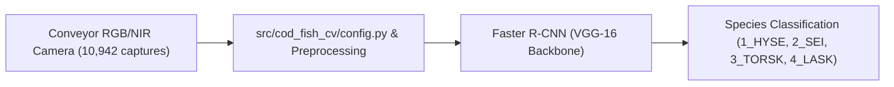

# `cod_fish_classification_keras_model` — Living Architecture Wiki

## System Context (C1)

## Module Index
- `src/cod_fish_cv/config.py`: Canonical species classes, RPN anchor scales `(128, 256, 512)`, anchor ratios, and conveyor ROI bounds `(0.05, 0.95)`.
- `tests/test_config.py`: Golden-master configuration tests.
